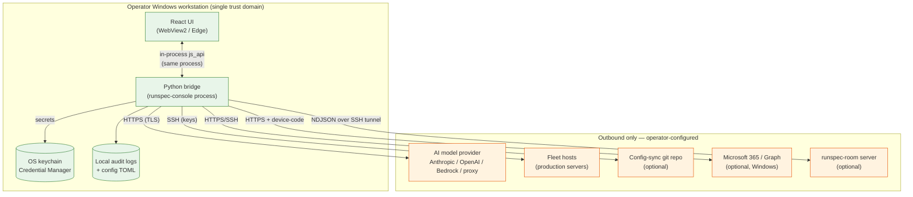
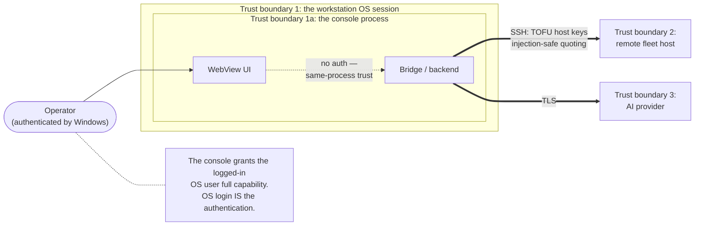
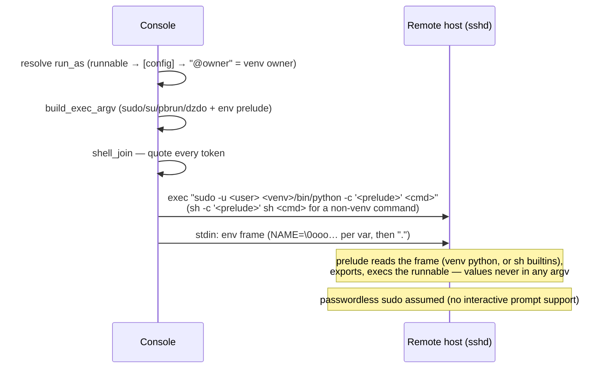
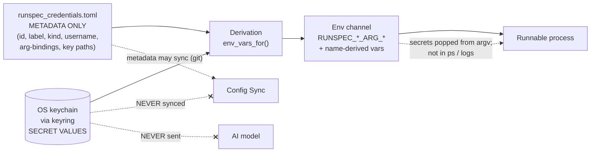
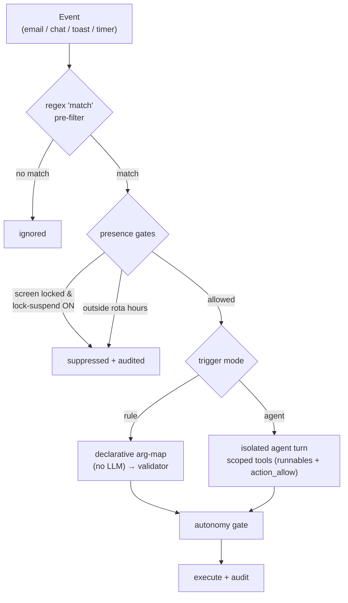
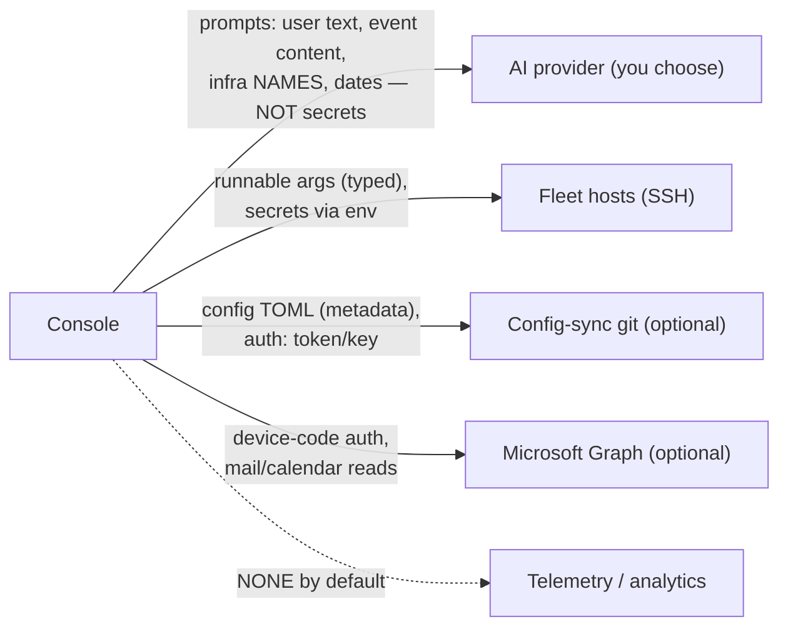

# Security architecture & assessment

**Audience:** Corporate information-security teams, IT architecture, and decision-makers
evaluating `runspec-console` for deployment. This is the document to hand to
your security team.

**Document status:** A source-grounded security architecture assessment,
maintained by the project and updated as security-relevant features land.
Honest and transparent by design — every claim below is annotated with the
source file that implements it (see the
[Verification appendix](#15-verification-appendix)), so it can be verified
against the product rather than taken on trust.

| Field | Value |
|---|---|
| Subject | `runspec-console` (desktop application) and its trust dependencies |
| Documented versions | console **0.187.0**, core `runspec` **0.50.0**, `runspec-room` **0.35.1** |
| Baseline in-depth review | console 0.148.0 (2026-06-29); sections below have been extended for security-relevant features added since (workspace code execution, agent configuration tools, saved-run presets) |
| Method | Source-code architecture review (read-only). **Not** a penetration test, not a third-party certification. |
| Platform in scope | Windows desktop (primary), with cross-platform notes |

> **What this document is, and is not.** This is a source-grounded security
> architecture review intended to let your security team make an informed risk
> decision and to scope their own validation. It is deliberately candid about
> residual risks and about which controls are true security boundaries versus
> operational/governance conveniences. It is **not** a substitute for an
> independent third-party penetration test or a formal threat-modelling
> workshop with your own threat actors — both of which we recommend before a
> fleet-wide rollout (see §13).

---

## 1. Executive summary (for decision-makers)

`runspec-console` is a **desktop application** that an operator installs on their
own Windows workstation. It gives that operator a single UI to run, schedule, and
monitor "runnables" (small, declared command-line tools) on their own machine and
across a fleet of **remote servers over SSH**, optionally with an **AI assistant**
that can propose and (with approval) take actions.

For a security audience, three properties matter most:

1. **It is a client, not a server.** The console opens *outbound* connections
   (SSH to fleet hosts, HTTPS to an AI provider, git for config). It does **not**
   listen for inbound network connections. Its local UI is served only to itself
   on `127.0.0.1`. The attack surface a network adversary can reach directly is
   essentially nil (§4, §10).

2. **AI actions are gated, not autonomous-by-default.** The system's default
   posture is **"confirm"** — the AI may *read* freely but must stop and get
   explicit human approval before it *changes* anything or runs anything not
   marked safe. The human-in-the-loop gate is enforced in code, fails closed on
   timeout, and **cannot be bypassed by the AI model itself** (§7). The operator
   can also *edit* a proposed action before approving it.

3. **Secrets are handled deliberately.** Credential secret values are stored in
   the **OS keychain** (Windows Credential Manager), never in the app's config
   files and never synced. Secrets reach a runnable through **environment
   variables, never the command line** (so they don't appear in `ps`/process
   listings or shell history), and they are **never sent to the AI model** (§6).

### Risk posture at a glance

| Dimension | Posture | Notes |
|---|---|---|
| Inbound network exposure (console) | **Very low** | No listening sockets; loopback-only UI (§4) |
| Remote execution safety | **Medium–good** | SSH with TOFU host-key verification + injection-safe quoting; depends on operator key hygiene (§5) |
| AI agent governance | **Good (by default)** | Confirm-by-default, fail-closed gate, secrets withheld from model; *misconfiguration* can widen it (§7, §8) |
| Secret handling | **Good** | OS keychain, env-channel, withheld from model & logs (§6) |
| Auditability | **Good (local)** | Structured per-run audit records with secret redaction; local files, not tamper-proof (§9) |
| Supply chain | **Medium** | Trusted-publisher PyPI release, but no artifact signing/SBOM; version floors not pins (§12) |
| Data egress to third parties | **Operator-controlled** | AI prompts go to the configured model provider; no hidden telemetry (§11) |
| Desktop-local trust | **By design, trusts the logged-in user** | No second auth layer on the app; the OS session *is* the boundary (§4) |

### The honest headline

`runspec-console` is built with a **defence-in-depth, safe-by-default** philosophy
and the security-relevant mechanisms are real and verifiable in code. The residual
risk is concentrated in three understood areas, all of which are manageable with
the deployment controls in §13:

- It **trusts the logged-in desktop user completely** (there is no second
  authentication layer inside the app). This is appropriate for a per-operator
  admin tool but means **workstation security is a prerequisite control**.
- Several powerful capabilities are **configuration-gated, not capability-removed**
  — e.g. an operator can configure an unattended trigger, or disable TLS
  verification for config-sync. Safe defaults exist; guardrails for *what
  operators may configure* are the enterprise's job (policy + §13).
- AI features inherit the **standard generative-AI risks** (prompt injection from
  untrusted email/chat content). The confirm-gate is the backstop, and it holds
  even against a manipulated model — but it relies on operators reading what they
  approve.

---

## 2. What the product is (plain-language primer)

- **Runnable:** a small program that declares its own interface (arguments,
  types, and an *autonomy level*) in a `runspec.toml` file. The core `runspec`
  library reads that declaration to validate inputs and to tell any caller — human
  or AI — what the tool does and whether it is safe to run unattended.
- **Console:** a Windows desktop app (built on
  [pywebview](https://pywebview.flowrl.com/) with a React UI) that discovers the
  runnables installed in its environment and lets an operator run them locally or
  on remote hosts over SSH, on a schedule, or in response to events.
- **AI companion:** an optional in-app chat assistant (backed by a model provider
  you choose) that can *propose* running those same runnables and a set of
  built-in tools, subject to the autonomy gate.
- **Room (optional, separate component):** `runspec-room` is a separate,
  *server-side* chat-relay product used for help-desk-style scenarios. It is **not**
  part of the desktop install and is assessed separately in §10 because its risk
  profile (a network-facing service) is fundamentally different.

---

## 3. System architecture

### 3.1 Component & deployment topology



**Key reading:** everything on the right is an **outbound** connection the
operator's own console initiates and authenticates. Nothing connects *in* to the
console.

### 3.2 Trust boundaries



There are three boundaries that matter:

- **Boundary 1 — the OS session.** The console authenticates *no one*; it assumes
  the person at the keyboard is the authorised operator, because Windows already
  authenticated them. **Consequence:** the security of the console is bounded by
  the security of the workstation login. This is the single most important thing
  for your team to internalise (§4).
- **Boundary 1a — within the process.** The UI and the Python backend run in the
  *same process*; the UI has unrestricted, unauthenticated access to all backend
  methods (this is the standard pywebview model). There is no sandbox between
  them. Because no *remote* content is loaded into the UI, there is no remote-XSS
  path to abuse this (§4).
- **Boundaries 2 & 3 — the network edges.** Crossing to a fleet host (SSH) or an
  AI provider (TLS) is where cryptographic controls apply (§5, §11).

---

## 4. Desktop application & UI trust boundary

| Property | Finding | Source |
|---|---|---|
| UI runtime | Microsoft Edge **WebView2** via pywebview on Windows | `app.py` (`main()`, window creation) |
| UI content origin | **Local bundled assets** (`dist/`) served by a loopback HTTP server, *or* a local Vite dev server in development | `app.py` (`_start_static_server`) |
| Network binding of the UI server | `127.0.0.1` on a **random ephemeral port** (loopback only) | `app.py` (`_start_static_server`, `HTTPServer(("127.0.0.1", 0), …)`) |
| External resources in the UI | **None** — no CDNs, no external fonts/scripts; all assets bundled by Vite | `console-ui/index.html`, bundle |
| Direct network calls from the UI | **None** — the React app makes no browser `fetch`/XHR to external origins; all data flows through the Python bridge | `console-ui/src/bridge/index.ts` |
| UI ↔ backend channel | pywebview `js_api`: the backend object is exposed to JavaScript in the same process | `app.py` (`js_api=bridge`) |
| Backend API surface | The full set of public methods is **frozen by a dedicated test** that fails on any addition or removal, guarding the surface from drift | `tests/test_bridge_api_surface.py` |
| Authentication between UI and backend | **None** — implicit same-process trust (no tokens/CSRF/origin checks) | `bridge.py` |
| App-level authentication / lock | **None** — no login, passphrase, or app lock screen | `app.py` (no auth path) |
| DevTools | DevTools *window* is off by default; opened only with `--dev`/`--devtools`. Right-click context menu is enabled | `app.py` (`_enable_native_context_menu`) |

**Security interpretation.** This is the conventional, well-understood
architecture for a single-user desktop admin tool. The two facts a security team
should record:

- **There is no second authentication factor inside the app.** Anyone with an
  unlocked, logged-in session of the operator's account has the operator's full
  capability — including SSH access to whatever fleet hosts the operator's keys
  reach. **Mitigation is environmental:** workstation disk encryption, screen-lock
  policy, and SSH-key protection (§13). The app provides a *governance* aid here —
  reactive automation pauses while the screen is locked (§9.2) — but this is
  explicitly **not** a security boundary.
- **The UI fully trusts the backend and vice-versa.** Because the UI loads only
  **local, first-party, bundled** content (no remote URLs, no external script
  origins, no CSP needed because there is no untrusted web origin), there is no
  network-driven path for an attacker to inject JavaScript into the WebView and
  drive the backend. The realistic abuse path requires *already* having code
  execution in the operator's session — at which point the console is not the
  weakest link.

---

## 5. Remote execution over SSH

This is the "production remote servers" concern. The console reaches fleet hosts
with **paramiko** (a mature pure-Python SSH implementation), reusing one
keep-alive connection per host for efficiency.

### 5.1 Host-key verification (anti-MITM)

The single most important control on this edge. The default is **`accept-new`
(trust-on-first-use)**, and crucially there is **no "accept anything" mode**:

```text
DEFAULT_HOST_KEY_CHECKING = "accept-new"
#   accept-new            → remember a new host's key; REJECT a changed key (default)
#   yes/true/strict       → only connect to hosts already in known_hosts
# There is deliberately NO "accept any key, every time" mode — that is the
# man-in-the-middle hole this design closes.
```
*(`executor.py`, host-key policy block)*

- A **changed** key for an already-known host raises paramiko's
  `BadHostKeyException` *before* the accept-new policy runs — so an
  on-path attacker who tries to impersonate a known host is **caught and
  rejected**.
- New keys are persisted to an **app-managed `known_hosts`** under the app-data
  directory (the operator's `~/.ssh/known_hosts` is read for verification but
  never rewritten).
- **Strict mode** (`[ssh] host_key_checking = "yes"`) is available for
  environments that pre-seed known-hosts and want to reject first-contact to
  unknown hosts entirely.

**Honest residual risk:** TOFU trusts the key presented on the *very first*
connection to a never-seen host. An attacker positioned on-path *at that exact
first contact* could plant a key. **Mitigation:** for high-assurance fleets,
deploy `known_hosts` via your config-management and set strict mode (§13). This
is the same trade-off as OpenSSH's own `StrictHostKeyChecking=accept-new`.

### 5.2 Authentication to hosts

| Aspect | Finding | Source |
|---|---|---|
| Primary auth | SSH **keys** (ed25519); per-host `identityFile` override or a global default | `executor.py`, `bridge_fleet.py` |
| Key generation helper | In-app ed25519 generation (OpenSSH PEM) + a `generate-ssh-key` console script | `bridge_config_ssh.py`, `tools/generate_ssh_key.py` |
| Key storage | App-data dir (e.g. `runspec_ed25519`); relies on filesystem ACLs | `bridge_config_ssh.py` |
| Password auth | **Bootstrap only** — a one-off password connection to *copy a key* (ssh-copy-id equivalent); password is tested then discarded, never stored or logged | `bridge_config_ssh.py` (`copy_ssh_id`), `executor.py` |
| SSH agent | Enabled (used for passphrase-protected keys) | `executor.py` |
| Key rotation | Safe rotate: generate aside → push → verify → swap | `bridge_config_ssh.py` |

### 5.3 Command construction (anti-injection)

Remote commands are assembled and then quoted with Python's `shlex.quote()` on
**every token** before being sent over the channel, so argument values containing
shell metacharacters are treated literally rather than interpreted:

- Argument list built in `executor.py` (`args_to_argv`), joined via a
  `shlex.quote`-based `shell_join`.
- Secrets are **never** placed in argv (see §6); environment-variable values are
  individually quoted.

**Interpretation:** this is the industry-standard defence and is applied
consistently. Injection risk via runnable arguments is **low**.

### 5.4 Privilege escalation on hosts (`run_as`)



- Escalation supports sudo/su/pbrun/dzdo; the *target identity* is resolved from
  the runnable's `run_as`, else its package's `[config] run_as`, else
  **`"@owner"` — the account that owns the venv** (found at discovery;
  `bridge_invoke.py`, core `runspec.become`). A shared venv owned by a service
  account therefore runs every tool as that account, and **sudoers is the access
  list**: whoever may `sudo -u svc` may run its tools. `"@owner"` never resolves
  to root, and nothing escalates when the owner is the login account.
- **No interactive sudo-password support** — escalation assumes **passwordless
  sudo** (`NOPASSWD` sudoers entries), which is the recommended, auditable
  pattern. A password-requiring sudo would simply hang.
- The core library independently enforces an **identity gate** (`enforce_run_as`):
  a runnable refuses to run if the effective user doesn't match its resolved
  `run_as` (modes `error`/`warn`/`off`). With the `"@owner"` default this means a
  shared venv's tools refuse to run directly as anyone but the owner — so an
  operator can't bypass sudoers by calling the venv's `bin/` directly (§9.4).

**Honest note:** passwordless-sudo scoping is therefore an operator/host
responsibility. The runspec model encourages narrow `sudoers.d` drop-ins (the
`runspec-linux` package even ships a `visudo`-validated bootstrap for scoped
rules), but the console cannot enforce how broad your sudoers entries are.

### 5.5 Proxy / jump hosts

HTTP `CONNECT` proxy and OpenSSH-config `ProxyCommand` are both supported
(`executor.py`), so the console works behind corporate bastions/middleboxes.
Connection pooling, capacity limits, and backoff are tunable in `[ssh]`
(`docs/console.md`, `docs/console-ssh-capacity.md`).

---

## 6. Credentials & secret handling



| Claim | Verified behaviour | Source |
|---|---|---|
| Secret *values* live in the OS keychain | `keyring.set_password("runspec-console", id, value)`; Windows Credential Manager / macOS Keychain / Secret Service | `credentials.py` (`set_secret`, `_keyring`) |
| Only *metadata* is written to disk | Persisted fields are `id, label, kind, username, username_arg, secret_arg, private_key, public_key` — **no secret field** | `credentials.py` (`_STR_FIELDS`, `save_credentials`) |
| Secrets reach runnables via **env, not argv** | Password-typed args are split out of argv into `RUNSPEC_<RUNNABLE>_ARG_<NAME>` env vars | `executor.py` (`secret_env`), `bridge_invoke.py` |
| Secrets survive `sudo`/`su` without touching a command line | Written to the process's **stdin** as the SPEC *env frame* and exported by a fixed `sh` prelude after the escalation, so no value is in any argv (`ps`, `/proc/<pid>/cmdline`) or in the `sudo` log. Before core 0.67.0 / console 0.305.0 they went through `env KEY=val` on the command line — readable by every user for the whole run and logged by `sudo`; rotate any credential used with a `run_as` runnable on an older version | `runspec.become` (`build_exec_argv`, `env_frame`), `executor.py` (`remote_exec_command`), `tests/test_secret_argv.py` |
| Config Sync carries metadata only | `runspec_credentials.toml` syncs; the keychain never does; merge is by identity, preserving local-only entries | `gitsync.py`, `configmerge.py` |
| Secrets are kept out of logs | Secrets are split out *before* the in-flight/audit record is built; only credential **ids** are recorded; core logging additionally redacts sensitive keys/patterns | `bridge_invoke.py`, `bridge_transfer.py`, core `logging_setup.py` |
| Secrets are withheld from the AI model | `password`-typed args are **omitted** from the agent's tool schema entirely (the model can't see or request them) | `catalog.py`, `tests/test_command_tools.py` |
| Env-var naming convention | label+kind → `JIRA_USERNAME`/`JIRA_PASSWORD`, with aliases (`*_USER`, `*_PAT`, `*_TOKEN`) for broad tool compatibility | `credentials.py` (`_KIND_ENV_FIELDS`, `env_vars_for`) |
| Keyring unavailable | Feature self-reports unavailable; saving a secret raises a clear error; reads degrade to `None`; **no silent fallback to disk** | `credentials.py` (`available`, `set_secret`, `get_secret`) |

**Honest residual risks (inherent, not defects):**

- **Env vars are visible to child processes.** A secret delivered via the env
  channel is, by design, in the environment of the runnable's process and any
  child it spawns. This is the standard Unix/Windows execution model; the design
  correctly prefers it over argv (which is world-visible in `ps`).
- **The keychain ACL is the trust boundary.** If the operator's OS session is
  compromised, the keychain is reachable to that session — same as any
  keychain-backed app. This is acceptable for a per-operator tool but reinforces
  §4's workstation-security prerequisite.
- **`tls_verify = false` escape hatch (Config Sync).** Disabling TLS verification
  for the config-sync git pull is possible for private-CA/proxy environments. It
  is opt-in and documented as "trusted network only," but your team should
  **prohibit it by policy** and prefer the `ca_bundle` route (§13).
- **Secrets are normal Python strings in memory** (not zeroised after use). A
  minor, well-understood residual for any Python application.

---

## 7. AI agent governance & human-in-the-loop

This is the centre of gravity for an AI-involved tool. The design is
**safe-by-default ("confirm"), fail-closed, and model-proof at the gate.**

### 7.1 The autonomy model

Four levels, ranked by restrictiveness, with **most-restrictive-wins** resolution:

```text
_AUTONOMY_RANK = {"autonomous": 0, "confirm": 1, "supervised": 2, "manual": 3}
```
*(`bridge_const.py`)*

Resolution order: **per-argument → runnable-level → `[config]` default → library
default (`confirm`)**. A `confirm` runnable with one `manual` argument becomes
effectively `manual` when that argument is used (`bridge_autonomy.py`,
`docs/agents.md`).

### 7.2 The gate (how a human stays in the loop)

```mermaid
sequenceDiagram
    participant M as AI model
    participant G as Autonomy gate (bridge)
    participant U as Operator (UI)
    participant X as Executor
    M->>G: proposes tool call (name + args)
    G->>G: resolve effective autonomy (most-restrictive-wins)
    alt manual
        G-->>M: refused (handed to human)
    else autonomous
        G->>X: run (no prompt)
    else confirm / supervised
        G->>U: render approval card (toast + taskbar flash)
        Note over G,U: blocks on event; 300s timeout = DENY (fail-closed)
        U-->>G: Approve / Deny (+ optional edited args)
        alt approved
            G->>X: run (edited args bypass the model entirely)
        else denied / timeout
            G-->>M: not run
        end
    end
    X-->>G: result -> audit record
```

Key properties, all verified in `bridge_autonomy.py`:

- The gate blocks the worker thread on a `threading.Event`; **a 300-second
  timeout is treated as deny** (no silent approval).
- **Edited confirmations:** the operator can change the arguments before
  approving; edited input goes straight to the executor and is **never round-
  tripped through the model**.
- **The model cannot approve its own calls.** Approval comes only from the UI
  calling `resolve_tool_confirmation(...)`. Even a prompt-injected or otherwise
  manipulated model response is still trapped by the gate — the model can *ask*,
  but only a human can *authorise*.

### 7.3 Built-in tool classification

| Capability class | Tools | Default autonomy |
|---|---|---|
| Read-only discovery / status | `search_runnables`, `describe_runnable`, `console_status` | **autonomous** |
| Read-only Microsoft 365 | `outlook_inbox`, `outlook_search`, `outlook_calendar`, `outlook_reminders`, … | **autonomous** |
| Read-only repo access | `repo_status`, `repo_list`, `repo_grep`, `repo_read`, `repo_diff` | **autonomous** |
| Local memory recall / review | `remember`, `search_memory`, `list_memories` | **autonomous** (local TOML, reversible; `list_memories` is a read-only enumeration for pruning) |
| **Forget** a memory | `forget_memory` | **confirm** — deletes a stored fact by id; the operator agrees to each prune |
| Read a runbook's steps | `run_runbook` | **autonomous** — it returns *text*; every runnable the steps then drive is gated individually at its own level |
| **Write** a runbook | `save_runbook` | **confirm** — a runbook is a procedure the agent (and every console it syncs to) will later follow |
| Session-workspace files | `workspace_ls`, `workspace_read`, `workspace_grep`, `workspace_write`, … | **autonomous** (read-only or path-jailed to the current session's workspace) |
| Denylist **read** | `manage_denylist action=list` | **autonomous** |
| Console-config **read** | `manage_hosts`/`manage_groups`/`manage_triggers`/`manage_saved_runs` `action=list`, `manage_rota action=get` | **autonomous** (read-only; see §7.4) |
| Read-only workspace SQL | `run_sql_sandboxed` (SELECT/EXPLAIN, read-only connection, in the WASM sandbox) | **autonomous** |
| **Write** to M365 | `outlook_draft`, `outlook_send`, `outlook_move`, `outlook_categorize`, … | **confirm** |
| **Write** to repo / files | `repo_write`, `repo_sync`, `download_file`, `relay_file` | **confirm** |
| Denylist **mutate**, schedules, documents, events, desktop actions | `manage_denylist add/all/clear/mode`, `create_schedule`, `create_document`, `emit_event`, `open_url`, `open_file`, `reveal_in_folder` | **confirm** |
| Console-config **mutate** | `manage_hosts`/`manage_groups`/`manage_triggers`/`manage_rota`/`manage_saved_runs` mutations | **confirm** — and chat-only (§7.4) |
| Sandboxed code execution | `run_python_sandboxed` (any snippet, in a WASM sandbox); `run_sql_sandboxed` writes/DDL | **always confirm** — the code runs in a WASI capability sandbox (workspace-only, no network, no host access, hard-timeout in a killable subprocess), *and* the confirm gate governs on top. Fail-closed: dropped entirely when the sandbox runtime is unavailable or `[workspace] code_exec = false` / `[sandbox] enabled = false`. See `docs/console-sandbox.md` |
| Run a runnable | `run_runnable` | **inherited from the target runnable's spec** |
| Run a saved preset | `run_saved_run` | **inherited from the underlying runnable(s)** — the gate expands the preset and resolves each target's autonomy (one grouped, editable confirm across a fan-out; most-restrictive wins; `manual` blocks), never a blanket action-tool prompt |

*(Classification: `bridge_const.py`, `bridge_autonomy.py`.)* The pattern is
consistent: **reads are free; writes and executions are gated.**

### 7.4 Automation cannot rewrite itself

The agent's console-configuration tools (`manage_hosts`, `manage_groups`,
`manage_triggers`, `manage_rota`, `manage_saved_runs`) are **chat-only**,
enforced in two independent layers (`bridge_const.py`, `bridge_triggers.py`,
`bridge_config_tools.py`):

1. The toolset of every trigger- or schedule-originated agent turn strips the
   config tools **unconditionally** — no per-trigger allowlist
   (`action_allow`) can re-admit them, and they are deliberately absent from
   the allowlist vocabulary.
2. The dispatch layer independently refuses any call whose registered run
   origin names a trigger — closing the path where a hand-written rule
   trigger names a config tool directly as its action.

The consequence a security reviewer cares about: **an automated turn can
never widen its own permissions** — it cannot create triggers, edit its
allowlists, change the fleet, alter working hours, or edit saved-run
presets. Only an interactive chat turn can propose those changes, and every
mutation still requires the operator's explicit confirmation. Credentials
and the AI-provider configuration have no agent tools at all (Settings UI
only).

### 7.5 What the model sees (and does not)

Sent to the provider: a system prompt (today's date, and an operational-context
block listing trigger/schedule/host-group/mailbox/repo **names and status**), the
tool schemas, and the user/event message. **Not** sent: secrets, credentials, API
keys, or password-typed args (§6). Hostnames and infrastructure *names* are
included so the assistant can target work — your team should treat **fleet
topology names as data that leaves to the provider** (§11).

---

## 8. Triggers, schedules & unattended automation

The console can act on events (new email, chat-room message, Windows toast) and on
timers. This is the most powerful capability and therefore the one to govern most
carefully.



| Control | Behaviour | Source |
|---|---|---|
| Pre-filter | A regex `match` runs **before** any agent turn — non-matching events never reach the model | `triggers.py` |
| Isolation | Each trigger/schedule agent turn runs in a throwaway history; it cannot see other conversations | `bridge_triggers.py` |
| Tool scoping | `runnables` allowlist (glob) bounds which runnables the turn can call; `action_allow` bounds built-in action tools | `bridge_triggers.py` |
| Rule mode | No LLM at all — event fields map to runnable args, **validated by the core validator**; multi-action groups fire behind **one grouped confirm** at most-restrictive autonomy | `bridge_triggers.py` |
| Config tools excluded | A trigger/schedule turn can **never** use the console-config tools — stripped from its toolset unconditionally and refused at dispatch (§7.4) | `bridge_triggers.py`, `bridge_config_tools.py` |
| Default autonomy | `confirm` for trigger-driven actions | `triggers.py` |
| Lock auto-suspend | Reactive triggers do **not** fire while the screen is locked; **fail-closed** (unknown probe ⇒ paused) | `winlock.py`, `bridge_triggers.py` |
| Rota / "take a break" | Operator can suspend reactive automation for a window; honours the lock screen on resume | `bridge_triggers.py`, `bridge_helpers.py` |

**Honest residual risk — the configuration cliff.** The guardrails above are
real, but they protect against accident more than against an operator who
*deliberately* configures broad automation. Specifically:

- A trigger in **agent mode with no `runnables` allowlist** can call any
  **autonomous** runnable without a human prompt. `action_allow` filters built-in
  action tools, **not** runnables — those are bounded by the `runnables`
  allowlist. This is documented, but it is a footgun.
- A **schedule** targeting a runnable whose autonomy is `autonomous` will fire on
  its timer with **no human approval** — by design (scheduling *is* the
  authorisation), but it means "what may be scheduled unattended" is a policy
  question for you.
- **Schedule-sourced jobs are exempt from lock-suspend** (they are pre-authorised,
  not reactions-while-away). Correct by design; worth knowing.

**Mitigation:** treat trigger/schedule configuration as a privileged change,
combined with the **denylist** (§9.1) as a fleet-wide backstop on which runnables
may ever execute. See §13.

---

## 9. Governance, audit & kill-switches

The project distinguishes — explicitly and honestly, in its own code comments —
between **hard security boundaries** and **operational/governance controls**. We
preserve that distinction here.

### 9.1 Denylist — a real enforcement boundary

- Every runnable invocation passes through the core `parse()`, which reads
  `{sys.prefix}/runspec_denylist.toml` and refuses runnables matched by
  name/effective-user/hostname globs (`denylist.py`, `parser.py`).
- Modes `enforce` (default) / `warn` / `off`; `disabled = true` blocks everything.
- Enforced **in the core binary on each host**, so it constrains *any* caller
  (human, AI, schedule) on that host — not just the console.
- The reserved name `runspec` is **exempt**, guaranteeing the control plane can
  never lock itself out (`runspec deny clear` always works as break-glass).
- The console can push denylist rules **fleet-wide** via the confirm-gated
  `manage_denylist` tool, which shells out to the core `runspec deny` command over
  SSH on each host (`bridge_agent_tools.py`).

**Classification:** a genuine, per-host kill-switch and security boundary —
checked on every invocation, unreachable by the runnable it blocks.

### 9.2 Lock auto-suspend & rota — governance, *not* security

The code is explicit (`bridge_triggers.py` docstring; `docs/design/lock-auto-suspend.md`):
this is a **presence-governance control** so unattended automation doesn't act
while the operator is away. It is **fail-closed** when enabled (an `unknown`
Windows probe ⇒ treated as locked) and **not** a defence against a determined
operator or a stolen, unlocked machine. We report it as such.

### 9.3 Audit logging — comprehensive, local, not tamper-proof

Every runnable invocation emits a structured `run_summary` record at process exit
(`logging_setup.py`) capturing: `run_id`, runnable + command path, duration, exit
code, agent flag, trigger source, runbook attribution, effective autonomy,
invoking user (and sudo target), per-arg values **and their provenance**
(`cli`/`env`/`spec_default`/…), and event-level counts. Sensitive keys and
patterns (passwords, bearer/basic auth, URL credentials) are **redacted** by a
filter on every handler.

**Honest limitation:** logs are **local files** (venv `logs/` or `~/logs/`). They
are suitable for accountability and forensics on a trusted workstation, but they
are **not tamper-resistant** against a privileged local user, and there is **no
built-in shipping to a central SIEM**. For enterprise audit, forward these files
to your log pipeline (§13).

### 9.4 `enforce_run_as` identity gate

The core library refuses to run a runnable on the direct path if the effective
user doesn't match its resolved `run_as` (modes `error`/`warn`/`off`,
`parser.py`/`become.py`) — a hard boundary that catches "ran a root-only tool as
the wrong user." Because `run_as` defaults to the venv owner, it also stops
anyone but the owner running a shared venv's tools directly. It checks identity,
not file access: someone who can read the venv can still run its Python code by
other means, so keep a shared venv's secrets out of files other accounts can
read.

### Control classification summary

| Control | Type | Honest classification |
|---|---|---|
| Denylist | Enforcement | **Security boundary** (per host, every invocation) |
| `enforce_run_as` | Enforcement | **Security boundary** (direct path) |
| Autonomy confirm-gate | Enforcement | **Security boundary** (human approval, model-proof, fail-closed) |
| Secret env-channel / keychain | Enforcement | **Security boundary** (secrets off argv/logs/model) |
| Host-key (TOFU/strict) | Enforcement | **Security control** (MITM-resistant after first contact) |
| Lock auto-suspend / rota | Governance | **Operational control, NOT a security boundary** (project says so) |
| Audit logging | Detective | **Accountability control** (local, not tamper-proof) |

---

## 10. Network surfaces & the optional Room server

### 10.1 The console itself

The console **does not listen** on any externally reachable socket. Its only
listeners are loopback (`127.0.0.1`) for serving its own UI. Room connectivity is
made by the console connecting **out** and tunnelling NDJSON over its existing SSH
connection to the host — i.e. the console is a **client** even to a room
(`sources/chat_transport.py`, `app.py`).

### 10.2 `runspec-room` (separate, optional, server-side)

`runspec-room` **is** a network-facing service (Starlette/uvicorn + SQLite). It is
**not** part of the desktop install; deploy it only if you adopt the help-desk
"rooms" feature. Its risk profile is a server's, and your team should review it
separately. Salient facts (`packages/console-room/`):

- **Two front doors:** (1) a browser web app for people, (2) an NDJSON door for
  consoles that is reachable **only over the SSH tunnel** (localhost-bound).
- **Authentication is email-verify only** (OIDC was removed). Sessions are signed
  cookies with a configurable TTL (default 24h). A **domain allowlist** (exact
  match, no wildcards) and an **operator allowlist** (exact email) gate access.
  Authorization equals visibility — the catalog filter is re-checked on submit, so
  a visitor can't request an operator-only entry.
- **The room is a "dumb pipe."** It relays messages and presence; it **never
  executes runnables itself.** Execution always happens back on an operator
  console, through that console's autonomy gate.
- **TLS** for the web door is operator-provided (cert/key) or terminated at a
  reverse proxy; the console door rides SSH encryption.

**Honest gaps for the room (if you deploy it):** no built-in rate-limiting on the
login/verify endpoints or websocket (DoS/brute-force considerations — though the
verify nonce uses high-entropy `uuid4`); generous default session TTL; dev mode is
unauthenticated and must never be used in production. These are standard
server-hardening items for your team to own.

### 10.3 Untrusted-input / prompt-injection surface

Email bodies and chat messages are **untrusted external input** that can become AI
prompts (capped at ~20 KB; no HTML sanitisation). This is the classic generative-AI
prompt-injection exposure. The layered backstops are: the regex `match` pre-filter,
the per-trigger `runnables`/`action_allow` scoping, and — decisively — the
**confirm-gate** on any write/execute action. A manipulated model still cannot
*authorise* an action; a human must. **We recommend explicit red-teaming of these
paths during your validation** (§13).

---

## 11. Data flows & egress (what leaves the machine)



| Destination | What goes there | Control |
|---|---|---|
| **AI provider** (Anthropic / OpenAI / Bedrock / a `base_url` proxy) | Prompts: operator/event text, tool schemas, infra **names**, dates. **No secrets.** | Provider & endpoint are operator-configured; you can point `base_url` at a corporate AI gateway. API key via static value or a `key_command`, never in prompts. |
| **Fleet hosts** | Typed/validated runnable args; secrets via env channel | SSH (encrypted), host-key verified (§5) |
| **Config-sync git** | Config TOML **metadata** (no secret values) | HTTPS (token) or SSH (key); `ca_bundle` for private CAs; `tls_verify=false` exists but should be policy-prohibited |
| **Microsoft Graph** (Windows, optional) | Mail/calendar reads; confirm-gated sends | MSAL **device-code** (public client, no stored secret); token cached locally |
| **Telemetry** | **Nothing.** No Sentry/Datadog/analytics/phone-home was found | Usage/token counts are logged **locally only** |

**The honest, important point for an AI-sceptical reviewer:** the console sends
**nothing to any third party by default except the AI provider you explicitly
configure**, and to that provider it sends prompts but **not secrets**. If your
policy requires AI traffic to stay inside your perimeter, set `[llm] base_url` to
an internal gateway (e.g. Bedrock in your AWS account, or an internal proxy) — the
adapter honours it.

---

## 12. Supply chain & build integrity

| Aspect | Finding | Source |
|---|---|---|
| Core library runtime deps | **Zero** on Python 3.11+ (stdlib only; `tomli` only on 3.10) | `runspec/pyproject.toml` |
| Console runtime deps | `pywebview`, `runspec`, `cryptography`, `paramiko`, `tomli-w` (+ Windows: `pywin32`; runnable pack `runspec-windows` via the optional `[windows]` extra; Microsoft 365 via optional `runspec-o365`) | `runspec-console/pyproject.toml` |
| AI/optional features | Extras: `anthropic`/`openai`/`bedrock`/`langserve`/`credentials`(keyring)/`git-sync`(dulwich)/`schedule`(apscheduler)/`notifications` | `runspec-console/pyproject.toml` |
| Version specifiers | **Floors (`>=`), not pins**; no lockfile | `pyproject.toml` files |
| Publishing | PyPI via **OIDC trusted publishing** (`pypa/gh-action-pypi-publish`); no long-lived PyPI secret | `.github/workflows/*release.yml` |
| Tag vs. publish | Decoupled: version bump auto-tags; publishing is a **manual** `workflow_dispatch` | `docs/releasing.md`, `auto-tag.yml` |
| Frontend bundling | Vite UI built and force-included into the wheel by a hatch hook | `hatch_build.py` |
| CI security scanning | CodeQL configured (Python + JS) but **gated to public repos** (skipped while private); Dependabot present | `.github/workflows/codeql.yml`, `dependabot-*.yml` |
| Artifact signing / SBOM / provenance | **None** (no Sigstore/GPG/SLSA/SBOM) | (absence) |

**Honest supply-chain posture:** delivery integrity to PyPI is good (trusted
publishing, no shared secret). The gaps are: **no artifact signing or SBOM**,
**version floors rather than pins** (a fresh install can pull newer transitive
versions), and **CodeQL effectively off** while the repository is private. None of
these are unusual for a young project, but a security-conscious enterprise should
compensate (§13): install from a **pinned, vetted internal index/lockfile**, and
generate/track an SBOM at packaging time on your side.

---

## 13. Recommended deployment controls (for a safe rollout)

These let an enterprise deploy widely while owning the residual risks above. They
are organised by who owns them.

**Workstation prerequisites (because the app trusts the OS session — §4):**
- Enforce full-disk encryption (BitLocker) and a short screen-lock timeout via GPO.
- Protect SSH private keys with passphrases + an agent; store keys on the
  encrypted profile; consider hardware-backed keys where feasible.
- Keep lock auto-suspend **ON** (default) as a governance aid — but do not treat it
  as a control.

**Fleet / SSH hardening (§5):**
- Pre-seed `known_hosts` via config management and set `[ssh] host_key_checking =
  "yes"` (strict) for high-assurance segments, eliminating first-contact TOFU.
- Scope `sudoers.d` drop-ins narrowly (specific commands, `NOPASSWD`) for the
  service accounts `run_as` targets — by default, each shared venv's owner — and
  grant them to a Unix group; never grant blanket sudo.
- Use per-operator or per-role SSH keys so audit logs attribute actions to people.

**AI & automation governance (§7, §8):**
- Mandate `runnables` allowlists on every agent-mode trigger; review schedules and
  triggers as privileged changes.
- Use the **denylist** as a fleet-wide backstop to hard-block runnables that must
  never run unattended; push it via Config Sync so every console inherits it.
- If AI traffic must stay in-perimeter, set `[llm] base_url` to an internal
  gateway / in-account Bedrock; document the chosen provider in your DPIA.
- Red-team the email/chat → agent paths for prompt injection before go-live.

**Secrets & config (§6, §12):**
- **Prohibit `tls_verify = false`** by policy; supply a `ca_bundle` for private CAs.
- Ensure the `credentials` (keyring) extra is installed so secrets land in
  Credential Manager, never on disk.
- Install from a **pinned internal package index** (mirror + hash-pinned lockfile)
  rather than open PyPI floors; generate an SBOM at mirror time.

**Audit & monitoring (§9.3):**
- Forward the console's local `logs/` JSON records to your SIEM (e.g. a log
  agent watching the venv `logs/` directory) for centralised, tamper-evident audit.

**If (and only if) you deploy `runspec-room` (§10.2):**
- Terminate TLS at a hardened reverse proxy; never run dev mode; set a short
  session TTL; add rate-limiting / WAF in front of the login + verify endpoints;
  restrict the domain/operator allowlists tightly.

---

## 14. Residual risk register (honest, consolidated)

| # | Risk | Likelihood | Impact | Inherent rating | Primary mitigation |
|---|---|---|---|---|---|
| R1 | Compromised/unlocked operator session ⇒ full console capability incl. fleet SSH | Med | High | **High** | Workstation hardening, screen lock, key passphrases (§13) |
| R2 | First-contact SSH MITM under default TOFU | Low | High | **Medium** | Strict mode + pre-seeded known_hosts (§5.1, §13) |
| R3 | Misconfigured unattended trigger/schedule runs on prod without approval | Med | High | **Medium–High** | Mandatory allowlists, denylist backstop, change control (§8, §13) |
| R4 | Prompt injection via untrusted email/chat steering the AI | Med | Med | **Medium** | Confirm-gate (model-proof), match pre-filter, scoping; red-team (§10.3) |
| R5 | Sensitive data (infra names, message content) sent to external AI provider | Med | Med | **Medium** | Operator-chosen provider; internal `base_url` gateway; DPIA (§11) |
| R6 | Broad/passwordless sudo scope on hosts | Med | High | **Medium** | Narrow `sudoers.d`, per-runnable scoping (§5.4, §13) |
| R7 | Supply chain: no signing/SBOM, version floors | Low | Med | **Medium** | Internal pinned index + SBOM; monitor advisories (§12, §13) |
| R8 | Local audit logs not tamper-proof / not centralised | Med | Low–Med | **Low–Medium** | Ship logs to SIEM (§9.3, §13) |
| R9 | `tls_verify=false` weakens config-sync transport | Low | Med | **Low–Medium** | Policy prohibition; use `ca_bundle` (§6, §13) |
| R10 | Room server (if deployed) lacks rate-limiting; generous session TTL | Med | Med | **Medium** (only if deployed) | Reverse proxy, WAF, short TTL (§10.2, §13) |
| R11 | Secrets visible to child processes via env channel; in-memory not zeroised | Low | Low | **Low** | Inherent to platform; accepted |

---

## 15. Verification appendix

The source repository is private; this published documentation is the
product's public surface. The file paths below are therefore a
**traceability map**, not links: each material claim in this document names
the file that implements it. They remain directly useful to your review —
the console and core library install as ordinary Python packages, so a
security team can verify each claim against the files inside their **own
installed copy** of the exact version they would deploy, without any
repository access. The fastest paths for a reviewer:

| Topic | Where to verify |
|---|---|
| Desktop process / loopback UI / no app auth | `packages/python/runspec-console/runspec_console/app.py`; `bridge.py`; `tests/test_bridge_api_surface.py` |
| SSH host-key policy (TOFU/strict, no "accept-anything") | `runspec_console/executor.py` (host-key policy block) |
| SSH auth, key gen/rotation, password-bootstrap-only | `runspec_console/bridge_config_ssh.py`; `executor.py`; `tools/generate_ssh_key.py` |
| Command quoting (anti-injection) | `runspec_console/executor.py` (`args_to_argv`, `shell_join`) |
| `run_as` escalation & identity gate | `runspec_console/bridge_invoke.py`; core `runspec/become.py`, `runspec/parser.py` |
| Secrets in keychain; metadata-only on disk | `runspec_console/credentials.py` (`_STR_FIELDS`, `set_secret`) |
| Secrets via env channel, withheld from model | `runspec_console/executor.py` (`secret_env`); `catalog.py`; `tests/test_command_tools.py` |
| Autonomy ranks & gate & editable confirms | `runspec_console/bridge_const.py`; `bridge_autonomy.py` |
| Built-in tool autonomy classification | `runspec_console/bridge_const.py`; `bridge_autonomy.py` |
| Trigger/schedule scoping & isolation | `runspec_console/bridge_triggers.py`; `triggers.py` |
| Lock-suspend / rota (governance, not security) | `runspec_console/winlock.py`; `bridge_triggers.py`; `docs/design/lock-auto-suspend.md` |
| Denylist enforcement | core `runspec/denylist.py`, `runspec/parser.py`; `bridge_agent_tools.py`; `docs/denylist.md` |
| Audit record & redaction | core `runspec/logging_setup.py`; `docs/logging.md` |
| Session workspace & code-exec gating | `runspec_console/workspaces.py`; `codeexec.py`; `bridge_agent_tools.py` |
| Chat-only config tools (two-layer exclusion) | `runspec_console/bridge_config_tools.py`; `bridge_triggers.py` (`_filter_headless_tools`); `tests/test_config_tools.py` |
| Saved-run presets & underlying-runnable gating | `runspec_console/savedruns.py`; `bridge_saved_runs.py`; `bridge_autonomy.py` (`run_saved_run` interception) |
| No telemetry / data egress map | `runspec_console/adapters/*`; `bridge_invoke.py`; absence of analytics SDKs |
| Supply chain / release | `*/pyproject.toml`; `.github/workflows/*release.yml`, `codeql.yml`; `hatch_build.py`; `docs/releasing.md` |
| Room server (if deployed) | `packages/console-room/` (`server.py`, `web/`, `signup.py`, `ndjson_server.py`) |

**Recommended next step before fleet rollout:** commission an **independent
third-party penetration test and threat-modelling workshop** scoped with this
document as input, plus a privacy/DPIA review for the AI-provider data flow (§11).
This assessment gives your team a verifiable map of the architecture and its
controls; it is the starting point for that validation, not a replacement for it.

---

*This document is maintained alongside the product and updated as
security-relevant features land. All findings derive from reading the source;
where the design makes an explicit honesty trade-off (e.g. "governance
control, not a security boundary"), this document preserves that language
rather than overstating the control.*
